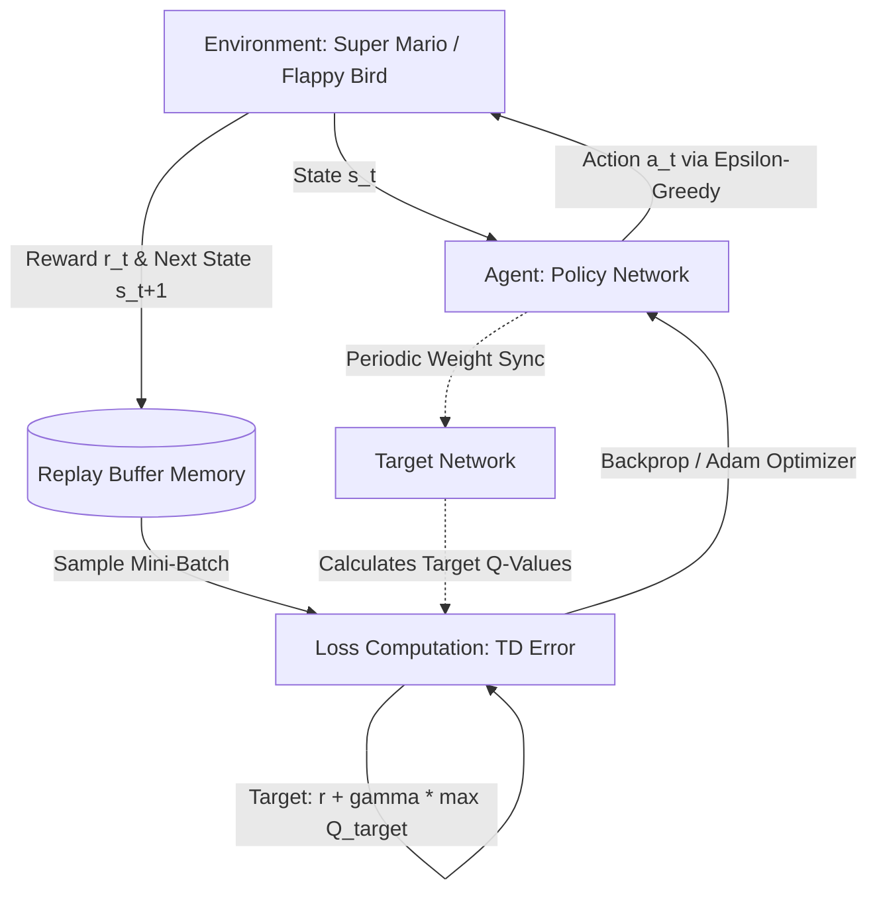

# 🎮 RL-Models — Deep Reinforcement Learning for Classic Games

> **Implementations of Deep Q-Networks (DQN) trained to master Super Mario Bros and Flappy Bird using PyTorch and Gymnasium/NES environments.**

This repository contains end-to-end Reinforcement Learning (RL) pipelines where autonomous agents learn to play complex arcade games directly from state observations (raw visual pixel frames and kinematic features).

---

## 📑 Table of Contents
- [Overview](#-overview)
- [Project Architecture](#-project-architecture)
- [Game 1: Super Mario Bros (Vision-Based DQN)](#-game-1-super-mario-bros-vision-based-dqn)
  - [Workflow & Pipeline](#mario-workflow--pipeline)
  - [Neural Network Architecture (`MarioNet`)](#neural-network-architecture-marionet)
  - [Included Files](#mario-included-files)
- [Game 2: Flappy Bird (Feature-Based DQN)](#-game-2-flappy-bird-feature-based-dqn)
  - [Workflow & Pipeline](#flappy-bird-workflow--pipeline)
  - [Hyperparameters & Configuration](#flappy-bird-hyperparameters--configuration)
  - [Included Files](#flappy-bird-included-files)
- [Core RL Theory & Flow](#-core-rl-theory--flow)
- [Installation & Setup](#-installation--setup)
- [How to Run and Evaluate](#-how-to-run-and-evaluate)
- [Pretrained Weights](#-pretrained-weights)

---

## 🧠 Overview

Reinforcement Learning involves an **Agent** interacting with an **Environment** to maximize cumulative **Rewards**:
1. The agent observes the current state $s_t$.
2. It chooses an action $a_t$ based on an exploration-exploitation policy ($\epsilon$-greedy).
3. The environment returns a scalar reward $r_t$ and transitions to a new state $s_{t+1}$.
4. The agent updates its neural network to predict expected future returns ($Q$-values) using the **Bellman Optimality Equation**:
   $$Q^*(s, a) = r + \gamma \max_{a'} Q^*(s', a')$$

This repository implements two distinct approaches:
* **Convolutional DQN (Computer Vision)** for Super Mario Bros (processing 4-frame stacked grayscale screen images).
* **Deep Q-Network (Kinematic States)** for Flappy Bird (processing distance and velocity state vectors).

---

## 📁 Project Architecture

```text
RL-Models/
├── mario/
│   ├── env.ipynb              # Environment creation & action space wrapper (SuperMarioBros-v0)
│   ├── preprocessing.ipynb    # Frame skipping, grayscale, 84x84 resize, 4-frame stacking
│   ├── model.ipynb            # Deep Convolutional Q-Network (MarioNet)
│   ├── replay_memory.ipynb    # Circular Experience Replay Buffer
│   ├── mario.ipynb            # Complete training loop, loss calculation, evaluation
│   ├── mario_best.pt          # Pre-trained checkpoint of highest performing agent
│   └── mario_checkpoint.pt    # Full training checkpoint (weights + optimizer state)
│
├── flappy_bird/
│   ├── game_flappy_bird.ipynb # Flappy Bird environment setup & rendering
│   ├── dqn.ipynb              # Multi-Layer Perceptron (MLP) Deep Q-Network
│   ├── exp_replay.ipynb       # Experience Replay Memory with deque
│   ├── parameters.yaml        # Training hyperparameters (gamma, alpha, epsilon)
│   ├── agent.ipynb            # Agent policy, Q-learning updates, and execution
│   └── runs/
│       ├── flappingbirdv0.pt  # Pretrained model weights
│       └── flappingbirdv0.log # Training logs & episode reward progression
│
├── .gitignore
└── README.md
```

---

## 🍄 Game 1: Super Mario Bros (Vision-Based DQN)

### Mario Workflow & Pipeline
1. **Environment Setup (`env.ipynb`)**:
   * Uses `gym-super-mario-bros` with the NES emulator (`nes-py`).
   * Constrains Mario's action space (e.g. `RIGHT_ONLY` or `COMPLEX_MOVEMENT`) to reduce action dimensionality.
2. **Visual Preprocessing (`preprocessing.ipynb`)**:
   * **Grayscale Conversion**: Eliminates color channels (3 channels ➔ 1 channel) to minimize compute without losing critical spatial details.
   * **Downsampling**: Resizes frames from raw NES resolution to a standardized $84 \times 84$ pixel grid.
   * **Frame Skipping**: Skips 4 frames per action, repeating the chosen action to simulate real human reaction times and accelerate training.
   * **Frame Stacking**: Stacks 4 consecutive frames into an $84 \times 84 \times 4$ tensor. This gives the agent temporal context (momentum, velocity, jumping direction).
3. **Replay Buffer (`replay_memory.ipynb`)**:
   * Stores transition tuples $(s_t, a_t, r_t, s_{t+1}, \text{done})$.
   * Randomly samples batches to break sequential correlation and stabilize gradient updates.
4. **Agent Training & Policy (`mario.ipynb`)**:
   * Employs an $\epsilon$-greedy exploration policy decaying from $\epsilon = 1.0$ down to a minimum exploration threshold.
   * Utilizes two networks: **Policy Net** (actively updated via gradient descent) and **Target Net** (periodically synchronized to prevent moving target instability).

### Neural Network Architecture (`MarioNet`)
```text
Input (4 x 84 x 84 Stacked Frames)
  │
  ▼
Conv2d(in=4, out=32, kernel=8, stride=4) + ReLU
  │
  ▼
Conv2d(in=32, out=64, kernel=4, stride=2) + ReLU
  │
  ▼
Conv2d(in=64, out=64, kernel=3, stride=1) + ReLU
  │
  ▼
Flatten (64 x 7 x 7 = 3136 units)
  │
  ▼
Linear(3136 -> 512) + ReLU
  │
  ▼
Linear(512 -> Action_Dim)  ==> Q-values for each action
```

### Mario Included Files
* **`mario_best.pt`**: Best recorded model weights achieved during training runs.
* **`mario_checkpoint.pt`**: Full training state checkpoint allowing seamless resumption of training.

---

## 🐦 Game 2: Flappy Bird (Feature-Based DQN)

### Flappy Bird Workflow & Pipeline
1. **Kinematic State Representation**:
   * Instead of raw pixels, the agent receives an observation vector representing game physics:
     * Bird vertical position and velocity.
     * Horizontal distance to the next pair of pipes.
     * Vertical distance to the upper and lower pipe gaps.
2. **Action Space**:
   * Discrete binary actions: `0` (Do nothing / fall due to gravity) or `1` (Flap wings / jump).
3. **Experience Replay (`exp_replay.ipynb`)**:
   * Maintains a memory bank storing up to 1,000,000 transitions.
   * Samples mini-batches of size 32 for batch gradient updates.
4. **Deep Q-Network (`dqn.ipynb`)**:
   * Dense Multi-Layer Perceptron (MLP) with 2 hidden layers ($256$ units) and ReLU activations.
5. **Agent & Training (`agent.ipynb`)**:
   * Computes Mean Squared Error (MSE) / Smooth L1 loss between current Q-estimates and Bellman target values.
   * Applies learning rate $\alpha = 0.01$ and discount factor $\gamma = 0.90$.

### Flappy Bird Hyperparameters & Configuration
Defined in `flappy_bird/parameters.yaml`:
```yaml
flappingbirdv0:
    env_id: FlappyBird-v0
    epsilon_init: 1.0           # Initial exploration rate (100% random actions)
    epsilon_min: 0.05           # Minimum exploration floor (5% random actions)
    epsilon_decay: 0.995        # Decay rate per episode
    replay_memory_size: 1000000 # Buffer capacity
    mini_batch_size: 32         # Transitions sampled per step
    network_sync_rate: 10       # Frequency of copying weights to target network
    alpha: 0.01                 # Learning rate (Adam/SGD optimizer)
    gamma: 0.9                  # Discount factor for future rewards
    reward_threshold: 1000      # Target score benchmark
```

---

## 🔄 Core RL Theory & Flow



---

## 💻 Installation & Setup

### 1. Prerequisites
* Python 3.8, 3.9, or 3.10
* PyTorch (with CUDA support if running on GPU, or CPU)
* Visual Studio C++ Build Tools (required on Windows for NES emulator compilation)

### 2. Install Dependencies
```bash
# Clone the repository
git clone https://github.com/Shantnu01/RL-Models.git
cd RL-Models

# Core Scientific & RL packages
pip install torch torchvision numpy pyyaml matplotlib opencv-python

# Super Mario Bros environment & NES emulator
pip install gym-super-mario-bros nes-py

# Flappy Bird environment
pip install flappy-bird-gymnasium pygame
```

---

## 🚀 How to Run and Evaluate

All models and experiments are organized in standalone Jupyter Notebooks (`.ipynb`).

### Running Super Mario Bros:
1. Navigate to the `mario/` directory:
   ```bash
   cd mario
   jupyter notebook
   ```
2. Open `mario.ipynb`.
3. **To train from scratch**: Run all cells sequentially. The notebook will initialize the wrapped environment, create the Replay Memory, and begin running episodes while tracking scores.
4. **To evaluate / watch a pretrained agent play**:
   Load the provided weights inside `mario.ipynb`:
   ```python
   import torch
   from model import MarioNet # or cell defining MarioNet

   model = MarioNet(input_dim=(4, 84, 84), output_dim=env.action_space.n)
   checkpoint = torch.load("mario_best.pt", map_location=torch.device("cpu"))
   model.load_state_dict(checkpoint)
   model.eval()
   ```

### Running Flappy Bird:
1. Navigate to the `flappy_bird/` directory:
   ```bash
   cd flappy_bird
   jupyter notebook
   ```
2. Open `agent.ipynb` and execute the cells to run or test the agent.
3. Pre-trained weights are located at `flappy_bird/runs/flappingbirdv0.pt` and training logs at `flappy_bird/runs/flappingbirdv0.log`.

---

## 📦 Pretrained Weights Included

| Game | File Path | File Size | Description |
| :--- | :--- | :--- | :--- |
| **Super Mario Bros** | `mario/mario_best.pt` | ~6.7 MB | Peak performing convolutional policy weights |
| **Super Mario Bros** | `mario/mario_checkpoint.pt` | ~26.9 MB | Complete state checkpoint for training resumption |
| **Flappy Bird** | `flappy_bird/runs/flappingbirdv0.pt` | ~900 KB | Trained MLP policy weights |

---

## 📜 License
This project is open-source and available under the [MIT License](LICENSE).
